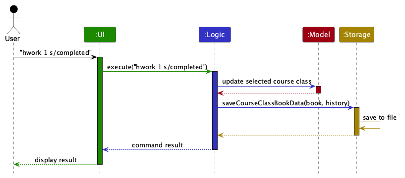
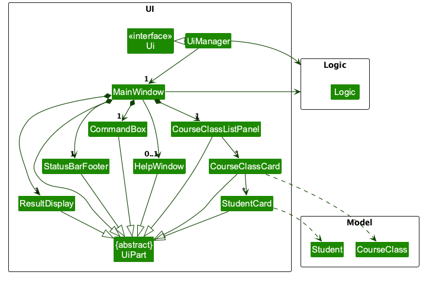
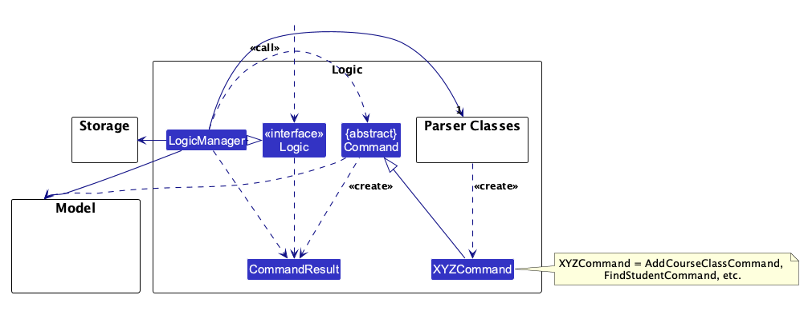
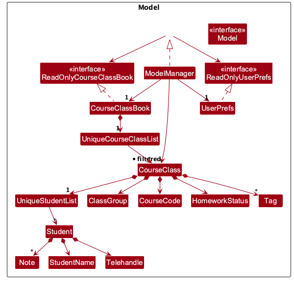
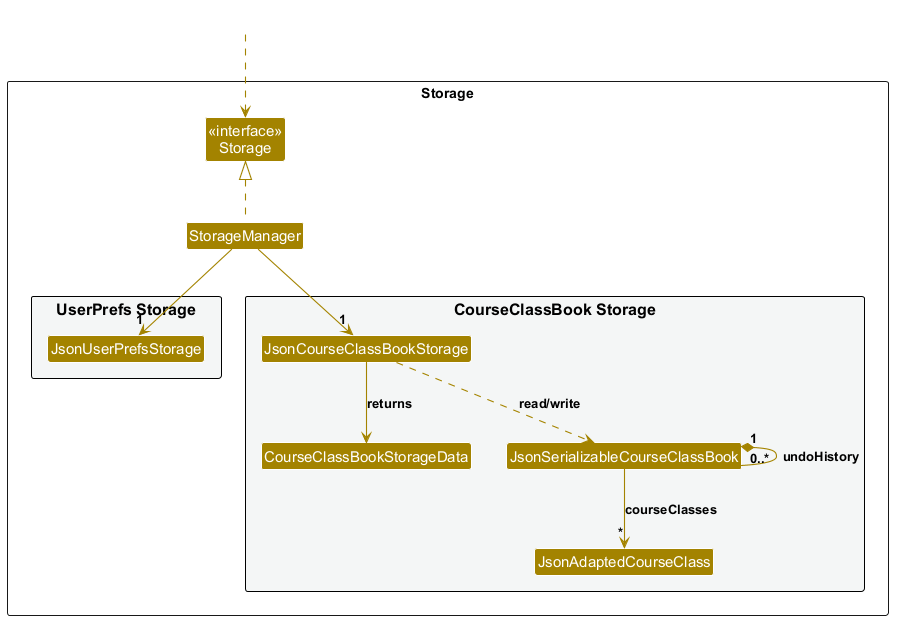
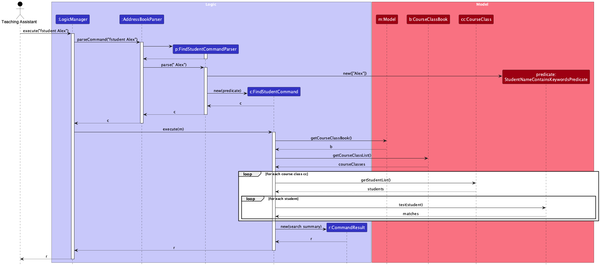
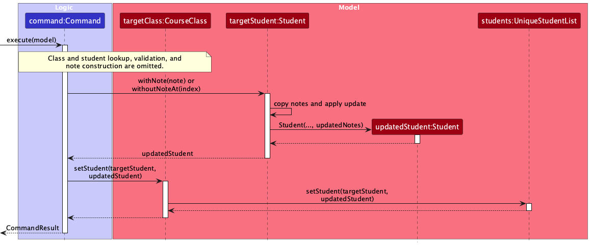
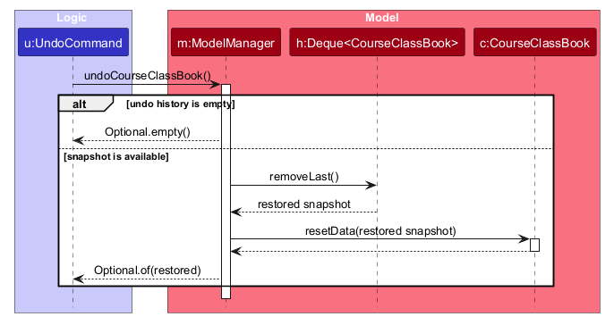

* Table of Contents
{:toc}

--------------------------------------------------------------------------------------------------------------------

## **Acknowledgements**

* Aiken Duet is adapted from [AddressBook-Level3](https://github.com/se-edu/addressbook-level3).
* The application uses [JavaFX](https://openjfx.io/), [Jackson](https://github.com/FasterXML/jackson),
  [JUnit 5](https://github.com/junit-team/junit5), and [PlantUML](https://plantuml.com/).

--------------------------------------------------------------------------------------------------------------------

## **Setting up, getting started**

Refer to the guide [_Setting up and getting started_](SettingUp.md).

--------------------------------------------------------------------------------------------------------------------

## **Design**

:bulb: **Tip:** The `.puml` files used to create diagrams are in `docs/diagrams`. Refer to the [_PlantUML Tutorial_ at se-edu/guides](https://se-education.org/guides/tutorials/plantUml.html) to learn how to create and edit diagrams.

### Architecture

The ***Architecture Diagram*** given above explains the high-level design of the App.

The following provides a quick overview of the main components and their interactions.

**Main components of the architecture**

**`Main`** (consisting of classes [`Main`](https://github.com/AY2627S1-CS2103T-F10-2/tp/blob/master/src/main/java/seedu/address/Main.java) and [`MainApp`](https://github.com/AY2627S1-CS2103T-F10-2/tp/blob/master/src/main/java/seedu/address/MainApp.java)) is in charge of the app launch and shut down.
* At app launch, it initializes the other components in the correct sequence, and connects them up with each other.
* At shut down, it shuts down the other components and invokes cleanup methods where necessary.

The bulk of the app's work is done by the following four components:

* [**`UI`**](#ui-component): The UI of the App.
* [**`Logic`**](#logic-component): The command executor.
* [**`Model`**](#model-component): Holds the data of the App in memory.
* [**`Storage`**](#storage-component): Reads data from, and writes data to, the hard disk.

[**`Commons`**](#common-classes) represents a collection of classes used by multiple other components.

**How the architecture components interact with each other**

The *Sequence Diagram* below illustrates the general interaction between the architecture components when a user
executes a command. Feature-specific interactions are documented in the [Implementation](#implementation) section.

Each of the four main components (also shown in the diagram above),

* defines its *API* in an `interface` with the same name as the Component.
* provides its functionality through a concrete `{Component Name}Manager` class that implements the corresponding API interface.

For example, the `Logic` component defines its API in `Logic.java` and implements it in `LogicManager.java`. Other components interact with a component through its interface rather than its concrete class, preventing them from coupling to that component's implementation, as illustrated in the following partial class diagram.

The sections below give more details of each component.

### UI component

The **API** of this component is specified in [`Ui.java`](https://github.com/AY2627S1-CS2103T-F10-2/tp/blob/master/src/main/java/seedu/address/ui/Ui.java).

The UI consists of a `MainWindow` and its parts, such as `CommandBox`, `ResultDisplay`,
`CourseClassListPanel`, and `StatusBarFooter`. Course-class cards contain their enrolled students, homework status,
and notes. All of these, including `MainWindow`, inherit from the abstract `UiPart` class, which captures common
behavior among classes that represent visible GUI parts.

The `UI` component uses the JavaFX UI framework. The layouts of these UI parts are defined in matching `.fxml` files
in `src/main/resources/view`. For example, [`MainWindow.fxml`](https://github.com/AY2627S1-CS2103T-F10-2/tp/blob/master/src/main/resources/view/MainWindow.fxml)
specifies the layout of [`MainWindow`](https://github.com/AY2627S1-CS2103T-F10-2/tp/blob/master/src/main/java/seedu/address/ui/MainWindow.java).

The `UI` component,

* executes user commands using the `Logic` component.
* listens for changes to `Model` data so that the UI can be updated with the modified data.
* keeps a reference to the `Logic` component, because the `UI` relies on the `Logic` to execute commands.
* depends on classes in the `Model` component because it displays `CourseClass` and `Student` objects.

### Logic component

**API** : [`Logic.java`](https://github.com/AY2627S1-CS2103T-F10-2/tp/blob/master/src/main/java/seedu/address/logic/Logic.java)

Here's a (partial) class diagram of the `Logic` component:

How the `Logic` component works:

1. When `Logic` is called upon to execute a command, the command is passed to an `AddressBookParser` object, which
   creates the matching feature parser where one is required.
1. This results in a `Command` object (for example, `AddCourseClassCommand`), which is executed by `LogicManager`.
1. The command can communicate with the `Model` when it is executed (for example, to add a course class). 
   Note that although this is shown as a single step in the diagram above for simplicity, the code can require several interactions between the command object and the `Model` to complete the operation.
1. The result of the command execution is encapsulated as a `CommandResult` object which is returned from `Logic`.

Here are the other classes in `Logic` (omitted from the class diagram above) that are used for parsing a user command:

How the parsing works:
* When called upon to parse a user command, the `AddressBookParser` class creates an `XYZCommandParser` (`XYZ` is a placeholder for the specific command name, e.g., `AddCommandParser`). The parser uses the other classes shown above to parse the user command and create an `XYZCommand` object (e.g., `AddCommand`). The `AddressBookParser` returns that object as a `Command` object.
* All `XYZCommandParser` classes, such as `AddCommandParser` and `DeleteCommandParser`, implement the `Parser` interface so they can be treated similarly where appropriate, for example during testing.

### Model component
**API** : [`Model.java`](https://github.com/AY2627S1-CS2103T-F10-2/tp/blob/master/src/main/java/seedu/address/model/Model.java)

The `Model` component,

* stores the course-class book, including `CourseClass` objects, enrolled `Student` objects, notes, and homework status.
* exposes course classes selected by the current filter in an unmodifiable `ObservableList<CourseClass>` that the UI
  can observe, so the displayed list updates when the model changes.
* stores snapshots of the course-class book for the persistent undo feature.
* stores a `UserPrefs` object that represents the user’s preferences (currently, just the GUI settings). This is exposed to the outside as a `ReadOnlyUserPrefs` object.
* does not depend on any of the other three components (as the `Model` represents data entities of the domain, they should make sense on their own without depending on other components)

### Storage component

**API** : [`Storage.java`](https://github.com/AY2627S1-CS2103T-F10-2/tp/blob/master/src/main/java/seedu/address/storage/Storage.java)

The `Storage` component,
* can save course-class data and user preference data in JSON format, and read them back into corresponding objects.
* is implemented by `StorageManager`, which delegates the actual file access to `JsonCourseClassBookStorage` and `JsonUserPrefsStorage`.
* uses `JsonSerializableCourseClassBook` to represent the current course-class book in JSON. Each item in `courseClasses` is represented by a `JsonAdaptedCourseClass`.
* stores the current course-class book and its `undoHistory` together in `data/courseclasses.json`. Each undo entry uses the same serializable structure and represents a complete previous `CourseClassBook` state.
* returns the current course-class book and its undo snapshots together through `CourseClassBookStorageData`, so the undo history is available after restarting the application.
* depends on some classes in the `Model` component because its job is to save and retrieve objects that belong to the `Model`.

### Common classes

Classes used by multiple components are in the `seedu.address.commons` package.

--------------------------------------------------------------------------------------------------------------------

## **Implementation**

This section describes some noteworthy details on how certain features are implemented.

### Adding a class: `aclass`

The `aclass` command creates a new `CourseClass` and adds it to the application's `CourseClassBook`. A course class
contains a class-group name, a course code, an optional set of tags, and an initially empty list of enrolled students.

#### Command parsing

`AddressBookParser` routes `aclass` to `AddCourseClassCommandParser`. The parser uses `ArgumentTokenizer` to read:

* `n/` for the class-group name; and
* `c/` for the course code.

Both prefixes are required and may appear in either order. `t/` is optional and may be repeated; repeated identical
tags are stored once because tags are represented as a set. The parser rejects a non-empty preamble, missing required
prefixes, and duplicate `n/` or `c/` prefixes. `ParserUtil` validates the name, course code, and tags before the
parser constructs the `CourseClass` and `AddCourseClassCommand` objects.

#### Execution and persistence

`AddCourseClassCommand#execute` first calls `Model#hasCourseClass`. Course-class identity is defined by
`CourseClass#isSameCourseClass`, which compares the class-group name and course code and ignores tags. If that identity
already exists, the command throws `This class already exists in the system.` Otherwise, it adds the class through
`Model#addCourseClass` and returns a formatted success message containing the class name, course code, and tags.

`ModelManager#addCourseClass` delegates to `CourseClassBook`, then resets the filtered course-class list so the new
class is immediately visible in the UI. After a successful command, `LogicManager` records an undo snapshot and saves
the complete course-class book and undo history through `Storage#saveCourseClassBookData`, so the new class is
persisted automatically.

The sequence diagram below shows the successful execution flow for
`aclass n/F10-2 c/CS2103T t/tutorial`.

#### Testing

The feature is covered by parser, command, integration, UI, and storage tests. In particular,
`AddCourseClassCommandParserTest` covers valid prefix order, optional and repeated tags, missing fields, preambles,
duplicate prefixes, and invalid values. `AddCourseClassCommandIntegrationTest` verifies that a class is added and that
an identical class is rejected. The broader course-class integration and storage tests verify display and persistence
behaviour.

### Updating class homework status: `hwork`

The `hwork` command stores one `HomeworkStatus` on the selected `CourseClass`. This value is shared by all enrolled
students in that class; it is not stored on individual `Student` objects.

#### Command parsing and execution

`AddressBookParser` routes `hwork` to `SetHomeworkStatusCommandParser`. The parser requires a positive displayed class
index and an `s/` status prefix. `ParserUtil` converts the status to one of `PENDING`, `COMPLETED`, or `NOT_SET`.
During execution, `SetHomeworkStatusCommand` validates the displayed index, updates only the selected class, preserves
the active course-class filter, logs the previous and new statuses, and returns a success message. `LogicManager` then
stores an undo snapshot and saves the updated course-class book together with the undo history through
`Storage#saveCourseClassBookData`.

The sequence diagram below shows the successful execution flow for `hwork 1 s/completed`. Parser interactions are
summarised at command creation so that the model, UI refresh, undo, and storage interactions remain readable.

#### Persistence and UI display

`JsonAdaptedCourseClass` serializes the status using its value such as `pending` or `completed`. When the field is absent
from older JSON data, storage defaults it to `NOT_SET`. `CourseClassCard` observes the class status property so the
homework badge updates when `hwork` changes an already displayed class card.

#### Testing

The feature is covered by parser, command, model, integration, storage, and UI tests. These tests verify class-level
updates, logging-related command execution, persistence, isolation between classes, preservation through class edits,
legacy JSON compatibility, and refresh of an existing homework-status badge.

### Removing a student from a class group: `dstudent`

The `dstudent` command removes one student's enrolment from one class group. It does not delete the student globally,
and it does not affect the student's enrolments in other class groups. A student's telehandle identifies the student,
while the class group and module identify the specific enrolment.

#### Command parsing

`AddressBookParser` routes the `dstudent` command to `DeleteStudentCommandParser`. The parser requires exactly one
value for each of the following prefixes:

* `t/` for the student's telehandle;
* `c/` for the class group; and
* `m/` for the module name.

`DeleteStudentCommandParser` rejects commands with missing or duplicate prefixes, a non-empty preamble, or invalid
field values. The parsed values are converted to `Telehandle`, `ClassGroup`, and `CourseCode` objects before a
`DeleteStudentCommand` is created.

#### Confirmation and execution

The command uses a two-step confirmation flow to prevent accidental removal:

1. `DeleteStudentCommand#execute` locates the `CourseClass` using the class group and module. If the class does not
   exist, it returns `Class group not found: CLASS_GROUP in MODULE_NAME`.
2. The command checks whether the class contains the supplied telehandle. If not, it returns
   `Student @TELEHANDLE is not enrolled in CLASS_GROUP in MODULE_NAME`.
3. Before confirmation, the command returns a preview message and does not modify the model.
4. `LogicManager` stores the unconfirmed command in `pendingDeleteStudentCommand`.
5. A subsequent `yes` creates a confirmed copy of the command. The command removes the student from the target
   `CourseClass`, and `LogicManager` persists the updated `CourseClassBook` and undo history through
   `Storage#saveCourseClassBookData`.
6. A subsequent `no` clears the pending command and returns a cancellation message without changing or saving data.
7. Any other confirmation input returns an error and leaves the pending deletion unchanged, allowing the user to
   enter `yes` or `no` again.

The model operation is scoped to the selected class: `CourseClass#removeStudent` delegates to
`UniqueStudentList#remove`, which removes the student by telehandle. Because each `CourseClass` owns its own enrolled
student list, removing an enrolment from one class does not remove the same student from another class.

The interaction between the parser, confirmation flow, model, and storage is shown below.

#### Testing

The feature is covered at parser, command, and logic-integration levels. The tests verify valid and invalid command
formats, missing classes, missing enrolments, confirmation and cancellation, invalid confirmation input, persistence,
and the case where the same student is enrolled in multiple classes.

### Student search feature

The student search feature is implemented by `FindStudentCommand`,
`FindStudentCommandParser`, and `StudentNameContainsKeywordsPredicate`.

When the user enters `fstudent KEYWORD [MORE_KEYWORDS]`, `AddressBookParser`
delegates the arguments to `FindStudentCommandParser`. The parser rejects an
empty keyword list and creates a `FindStudentCommand` containing a
`StudentNameContainsKeywordsPredicate` otherwise.

During execution, `FindStudentCommand` visits the enrolled-student list of each
course class in the model. The predicate performs a case-insensitive, full-word
comparison and accepts a student when any keyword matches the student's name.
The command returns every matching enrolment with the student's Telegram
handle, class group, and module code, allowing similarly named students and
multiple enrolments to be distinguished.

The sequence diagram below shows the successful search path. It focuses on
command parsing and the read-only traversal of the model. Formatting of each
matching result and persistence are omitted: formatting is internal to
`FindStudentCommand`, while a search does not modify stored data.

This approach searches the existing per-class student lists instead of
introducing a separate global student index. It keeps the first feature
increment small and avoids duplicating enrolment data, while still satisfying
the current requirement to search across all classes.

#### Testing

The feature is tested at the parser, predicate, command, and top-level command-routing levels.
The tests cover blank input, whitespace-separated keywords, case-insensitive full-word matching,
OR matching for multiple keywords, no matches, result details, and the same student enrolled in
multiple classes.

### Student notes feature

The student notes feature is implemented by `AddNoteCommandParser`,
`AddNoteCommand`, `DeleteNoteCommandParser`, `DeleteNoteCommand`, `Note`, and
the note-related behaviour in `Student` and `StudentCard`.

#### Model and command execution

`Note` is an immutable value object containing non-blank text and a
`LocalDateTime` timestamp. Each `Student` stores an unmodifiable list of notes.
Note addition and deletion therefore use an immutable copy-and-replace
approach: `Student#withNote` and `Student#withoutNoteAt` return an updated
`Student`, which replaces the original enrolment in the relevant `CourseClass`.
The original `Student` and the order of all retained notes remain unchanged.

The diagram focuses on a successful update within the Model domain. Class and
student lookup, validation failures, note construction, logging, UI refresh,
and persistence are omitted because they are covered elsewhere in this guide.
If validation fails, the student replacement does not occur.

The command execution flow is as follows:

1. `AddressBookParser` delegates a `note` command to `AddNoteCommandParser`.
1. `AddNoteCommandParser` parses the telehandle, class group, and module name.
   The `o/` parameter must appear last and marks the start of the remaining
   free-text observation, allowing the observation itself to contain
   prefix-like text.
1. `AddNoteCommand` locates the `CourseClass` using the class group and module
   name, then locates the enrolled `Student` using the telehandle. The command
   fails without modifying data if either cannot be found.
1. The command creates a `Note` using the observation and the current system
   date and time. It calls `Student#withNote` and replaces the original student
   through `CourseClass#setStudent`; `UniqueStudentList#setStudent` preserves
   the student's position in the class.
1. After successful execution, `LogicManager` asks `StorageManager` to save the
   updated course-class book.

Note deletion proceeds as follows:

1. `AddressBookParser` delegates a `dnote` command to
   `DeleteNoteCommandParser`, which parses the class, student, and one-based note
   index.
1. `DeleteNoteCommand` locates the specified class and student. It validates the
   index against that enrolment's current note list before making any change.
1. The command calls `Student#withoutNoteAt` using the zero-based index and
   replaces the original student through `CourseClass#setStudent`.
1. `LogicManager` saves the updated course-class book. If the class, student, or
   note index is invalid, the command throws a `CommandException` before
   replacing the student, so stored data remains unchanged.

#### Persistence

`JsonAdaptedStudent` converts each note using `JsonAdaptedNote`, which stores
the note text and timestamp in `data/courseclasses.json`. When the application
starts, the storage component validates and restores both fields, preserving
the order of the student's notes. Stored students without a `notes` field
remain compatible and are loaded with an empty note list.

#### UI display

`CourseClassCard` listens for changes to its observable student list and
refreshes the affected student cards after a note is added or deleted.
`StudentCard` numbers and displays each note below the student's name and
Telegram handle in stored order. The one-based number shown here is the index
accepted by `dnote`. Timestamps use the format `dd MMM yyyy, HH:mm`, and note
labels wrap long text. The notes container is hidden for students without notes.

#### Testing

The feature is tested at the model, parser, command, routing, storage-integration,
and UI levels. Tests cover deletion from different list positions, invalid
indexes, missing classes and students, isolation between enrolments, immutable
student updates, UI renumbering, and persistence after reloading the data file.

### Undoing course-class changes: `undo`

#### Implementation

The `undo` command restores the course-class data to the state before the most recent successful data-changing command. It uses a last-in-first-out stack of complete `CourseClassBook` snapshots. Each snapshot includes course-class metadata, enrolled students, notes, and homework status.

`AddressBookParser` routes `undo` to `UndoCommandParser`, which accepts no arguments. `Command#isMutating()` identifies commands that can change course-class data. Before such a command executes, `LogicManager` copies the current course-class book. The snapshot is added to the undo stack only after the command succeeds and actually changes the stored data.

Commands that create undo snapshots include:

* `aclass`, `add`, `eclass`, and `cclass`
* confirmed `dclass` and `dstudent`
* `note` and `dnote`
* `hwork`

Search, list, help, and exit do not create snapshots. Failed commands and cancelled `dstudent` confirmations do not create snapshots. A preview is not recorded; only a confirmed deletion is.

When `undo` executes, `ModelManager` removes the latest snapshot from its `Deque<CourseClassBook>` and restores it. Repeating `undo` walks backwards through the stack. Redo is not implemented.

#### Undo command sequence

Read both diagrams from top to bottom. Each horizontal arrow represents one
method call.

##### Logic-level diagram

The user first enters `undo`. `LogicManager` sends the command text to
`AddressBookParser`, which creates an `UndoCommand`. `LogicManager` then
executes the command, and `UndoCommand` asks the `Model` to run
`undoCourseClassBook()`.

The `Model` returns either a restored snapshot or an empty result if there is no
history. If the operation succeeds, `UndoCommand` creates a success result.
`LogicManager` then saves the restored course-class book and the remaining undo
history through `Storage`. Finally, the success message is returned to the user
interface. The diagram simplifies the parser step by treating
`UndoCommandParser` as part of `AddressBookParser`.

##### Model-level diagram

This diagram zooms in on the model restoration step. `UndoCommand` calls
`ModelManager.undoCourseClassBook()`, and `ModelManager` checks the
`Deque<CourseClassBook>`. If the deque is empty, it returns `Optional.empty()`.
Otherwise, it calls `removeLast()` to obtain the latest saved snapshot.
`ModelManager` then calls `resetData(...)` on the current `CourseClassBook` and
returns the restored state to `UndoCommand`.

#### Persistence

Undo uses the existing course-class JSON storage rather than a separate storage system. `JsonCourseClassBookStorage` saves the current book and snapshots together in `data/courseclasses.json`. The existing `courseClasses` data remains, with an `undoHistory` list containing serialized previous books.

`MainApp` loads both the current book and `undoHistory` into `ModelManager`. After successful commands, `LogicManager` saves both; undo saves the restored current state and the remaining history. Older JSON files without `undoHistory` remain compatible and start with an empty undo stack.

Course-class saves use a temporary file before moving the completed data into place. An atomic move is used when supported, with a replacement fallback otherwise.

#### Design considerations

* Snapshot history was chosen to keep related course-class data consistent and avoid requiring every command to implement its own inverse operation.
* Storing complete snapshots uses more memory and storage than storing command-specific inverse data. A history limit could be considered in the future.
* Reusing the existing JSON file keeps current data and undo history together across application restarts.

#### Testing

`UndoCommandTest` covers restoration and an empty undo stack. `UndoLogicIntegrationTest` covers last-in-first-out behaviour, class deletion, student removal, homework status, failed and cancelled commands, and restart persistence. `MainAppTest` verifies startup history loading, while storage tests verify round-trip persistence and compatibility with legacy JSON without `undoHistory`.

### \[Proposed\] Data archiving

_{Explain here how the data archiving feature will be implemented}_

--------------------------------------------------------------------------------------------------------------------

## **Documentation, logging, testing, dev-ops**

* [Documentation guide](Documentation.md)
* [Testing guide](Testing.md)
* [Logging guide](Logging.md)
* [DevOps guide](DevOps.md)

--------------------------------------------------------------------------------------------------------------------

## **Appendix: Requirements**

### Product scope

**Target user profile**:

* is a teaching assistant who manages students across multiple classes and class groups
* needs to retrieve student information and record teaching observations quickly
* prefers a desktop application that stores teaching data locally
* can type quickly and is comfortable using CLI-style commands

**Value proposition**: Aiken Duet helps teaching assistants manage classes, student enrolments, and teaching observations efficiently, with fast keyboard-driven access to information across multiple class groups.

### User stories

Priorities: Must-have - `* * *`, Should-have - `* *`, Nice-to-have - `*`

| Priority | As a …​ | I want to …​ | So that I can…​ |
| -------- | ------- | ------------- | ---------------- |
| `* * *` | teaching assistant | add a class | add students to it |
| `* * *` | teaching assistant | add a student | keep track of students in my class |
| `* * *` | teaching assistant | view all my students in a list | see who I am managing |
| `* * *` | teaching assistant | search for a student by name | quickly retrieve their details |
| `* * *` | teaching assistant | search for a class by name | quickly retrieve its details |
| `* * *` | teaching assistant | edit a student's details | keep their information up to date |
| `* * *` | teaching assistant | add a note about a student | remember important teaching-related observations |
| `* *` | teaching assistant | remove a student from a class group | stop managing that student's enrolment in the class without affecting other classes |
| `* *` | teaching assistant | delete a class | remove classes I no longer manage |
| `* *` | teaching assistant | undo a deletion of a student | undo the removal of a student I made by mistake |
| `* *` | teaching assistant | undo a deletion of a class | undo the removal of a class I made by mistake |
| `* *` | teaching assistant | view an individual's homework | grade their work |
| `* *` | teaching assistant | view an individual's progress | monitor their efforts |
| `* *` | teaching assistant | schedule consultation slots | organize meetings with my students |
| `* *` | teaching assistant | view students who were absent from a class | identify students who may need a follow-up |
| `* *` | teaching assistant | view all students in a specific tutorial or lab group | manage one class at a time |
| `* *` | teaching assistant | record a student's attendance for a class | keep track of their attendance history |
| `* *` | teaching assistant | record a student's participation in class | keep track of their engagement |
| `* *` | teaching assistant | view students with incomplete assignments | identify who may need reminders |
| `* *` | teaching assistant | record the date and topic of a consultation | remember what was discussed with a student |
| `* *` | teaching assistant | view a student's previous consultations | prepare for them |
| `* *` | teaching assistant | mark pending follow-up tasks as completed | keep track of outstanding work |
| `* *` | teaching assistant | view a summary of a tutorial group | quickly understand its overall attendance, participation, and assignment status |
| `*` | teaching assistant | archive my previous tasks | keep my list clean |
| `*` | teaching assistant | view archived tasks | look back at my history if needed |
| `*` | teaching assistant | see students who may be falling behind | follow up with them |
| `*` | teaching assistant | set repeating weekly tasks | avoid recreating routine duties each week |
| `*` | teaching assistant | tag tasks by assignment or exam name | organize duties by course milestones |
| `*` | teaching assistant | set priority levels for tasks | focus on time-sensitive duties such as exam preparation first |
| `*` | teaching assistant | view my tasks in a calendar | see how course duties overlap with my own academic exam schedule |
| `*` | teaching assistant | log the estimated and actual hours spent on each task | stay within my contracted weekly hours limit |
| `*` | teaching assistant | transfer an assigned task to another teaching assistant with an explanation | ensure it is completed if an emergency prevents me from doing it |

### Use cases

#### UC01 — Add a class group

**System:** Aiken Duet

**Actor:** Teaching Assistant

**MSS:**

1. The Teaching Assistant requests to create a class group.
2. Aiken Duet requests the class group name and details.
3. The Teaching Assistant provides the requested details.
4. Aiken Duet creates the class group with the relevant details.

   Use case ends.

**Extensions:**

* 3a. Aiken Duet detects an error in the provided details.
  * 3a1. Aiken Duet informs the Teaching Assistant of the error.
  * 3a2. Aiken Duet requests the correct details.
  * 3a3. The Teaching Assistant provides new details.
  * Steps 3a1–3a3 are repeated until the details are valid.
  * Use case resumes from step 4.
* 3b. A class group with the same details already exists.
  * 3b1. Aiken Duet informs the Teaching Assistant that a class group with the same details already exists.
  * Use case ends.

#### UC02 — Add a student to a class group

**System:** Aiken Duet

**Actor:** Teaching Assistant

**MSS:**

1. The Teaching Assistant requests to add a student to a class group.
2. Aiken Duet requests the student details and class group.
3. The Teaching Assistant provides the requested details.
4. Aiken Duet creates the student record, enrols the student in the specified class group, and confirms the addition.

   Use case ends.

**Extensions:**

* 3a. Aiken Duet detects an error in the provided details.
  * 3a1. Aiken Duet informs the Teaching Assistant of the error.
  * 3a2. Aiken Duet requests the correct details.
  * 3a3. The Teaching Assistant provides new details.
  * Steps 3a1–3a3 are repeated until the details are valid.
  * Use case resumes from step 4.
* 3b. The specified class group does not exist.
  * 3b1. Aiken Duet informs the Teaching Assistant that the class group cannot be found.
  * Use case ends.
* 3c. The student is already enrolled in the specified class group.
  * 3c1. Aiken Duet informs the Teaching Assistant that the enrolment already exists.
  * Use case ends.
* 3d. The student already exists but is not enrolled in the specified class group.
  * 3d1. Aiken Duet enrols the existing student in the specified class group.
  * 3d2. Aiken Duet confirms the addition.
  * Use case ends.

#### UC03 — Add a note about a student

**System:** Aiken Duet

**Actor:** Teaching Assistant

**MSS:**

1. The Teaching Assistant requests to add a note about a student.
2. Aiken Duet requests the student and note details.
3. The Teaching Assistant provides the requested details.
4. Aiken Duet adds the note to the student's record and confirms the addition.

   Use case ends.

**Extensions:**

* 3a. Aiken Duet detects an error in the provided details.
  * 3a1. Aiken Duet informs the Teaching Assistant of the error.
  * 3a2. Aiken Duet requests the correct details.
  * 3a3. The Teaching Assistant provides new details.
  * Steps 3a1–3a3 are repeated until the details are valid.
  * Use case resumes from step 4.
* 3b. The specified student does not exist.
  * 3b1. Aiken Duet informs the Teaching Assistant that the student cannot be found.
  * Use case ends.

#### UC04 — Search for a student

**System:** Aiken Duet

**Actor:** Teaching Assistant

**MSS:**

1. The Teaching Assistant enters `fstudent KEYWORD [MORE_KEYWORDS]`.
2. Aiken Duet searches student enrolments across all class groups by name.
3. Aiken Duet displays each matching enrolment with the student's name, Telegram handle,
   class group, and module.

   Use case ends.

**Extensions:**

* 1a. The command does not contain a keyword.
  * 1a1. Aiken Duet displays the valid command format.
  * Use case ends.
* 2a. No matching student enrolment is found.
  * 2a1. Aiken Duet informs the Teaching Assistant that no matching student enrolment was found.
  * Use case ends.

#### UC05 — Remove a student from a class group

**System:** Aiken Duet

**Actor:** Teaching Assistant

**MSS:**

1. The Teaching Assistant enters `dstudent t/TELEHANDLE c/CLASS_GROUP m/MODULE_NAME`.
2. Aiken Duet locates the specified class group and enrolled student.
3. Aiken Duet displays the matching student and asks the Teaching Assistant to enter `yes` or `no`.
4. The Teaching Assistant enters `yes`.
5. Aiken Duet removes the student's enrolment from the specified class group, saves the updated class data, and
   confirms the removal.

   Use case ends.

**Extensions:**

* 1a. Aiken Duet detects missing, duplicate, or invalid command fields.
  * 1a1. Aiken Duet displays the valid command format.
  * Use case ends.
* 2a. The specified class group does not exist.
  * 2a1. Aiken Duet informs the Teaching Assistant that the class group cannot be found.
  * Use case ends.
* 2b. The specified student is not enrolled in the class group.
  * 2b1. Aiken Duet informs the Teaching Assistant that the enrolment cannot be found.
  * Use case ends.
* 4a. The Teaching Assistant enters a value other than `yes` or `no`.
  * 4a1. Aiken Duet asks the Teaching Assistant to enter `yes` or `no` again.
  * Use case resumes from step 4.
* 4b. The Teaching Assistant enters `no`.
  * 4b1. Aiken Duet cancels the operation and confirms that no records were changed.
  * Use case ends.

### Non-Functional Requirements

1. Aiken Duet should work on any _mainstream OS_ with Java `25` installed.
2. Aiken Duet should respond to add, edit, delete, list, and find commands within 2 seconds when storing up to 100 classes and 1,000 students on a typical laptop.
3. A teaching assistant who is familiar with CLI applications should be able to create a class, add a student, find that student, and record an observation within 15 minutes of first using Aiken Duet with the User Guide available.
4. Aiken Duet should store its data locally and should not transmit student information over a network unless the user explicitly initiates such an operation.
5. Invalid commands should not modify existing class, student, enrolment, or teaching-observation data, and should not cause Aiken Duet to terminate unexpectedly.
6. Aiken Duet should parse and save application data within 2 seconds.
7. Should the local save file be corrupted, the system should not overwrite the corrupted file with a blank slate and should alert the user of the error.
8. The data file must be saved in a standard location such as a data folder at the root directory.
9. The teaching assistant should only need the JAR file to run the application and should not need to install any
   dependency other than Java 25.
10. Saved data should be in an easy to edit format for ease of changing in case of save data corruption.

### Glossary

* **Class**: A course offering managed in Aiken Duet and identified by a course code.
* **Class group**: A tutorial, laboratory, or recitation group belonging to a class.
* **Class tag**: A user-defined label used to categorize a class.
* **Consultation**: A scheduled meeting between a teaching assistant and a student, together with any recorded date and topic.
* **Enrolment**: The association between a student and a class group.
* **Follow-up task**: An action that a teaching assistant needs to complete after a class, consultation, or student interaction.
* **Homework**: Work assigned to an individual student for completion outside class.
* **Mainstream OS**: Windows, Linux, Unix, or macOS.
* **Participation**: A record of a student's engagement during a class.
* **Student**: A learner whose details, class-group enrolments, and teaching observations are managed in Aiken Duet.
* **Task**: A teaching-related duty tracked by a teaching assistant, which may have a status, priority, schedule, tag, or time record.
* **Teaching observation**: A timestamped note about a student in the context of a specific class group.
* **Telehandle**: A student's username on a messaging platform used for communication.
* **Typical laptop**: A computer with at least a 2 GHz dual-core processor and 8 GB of RAM.

--------------------------------------------------------------------------------------------------------------------

## **Appendix: Instructions for manual testing**

Given below are instructions to test the app manually.

:information_source: **Note:** These instructions only provide a starting point for testers to work on;
testers are expected to do more *exploratory* testing.

### Launch and shutdown

1. Initial launch

   1. Download the JAR file and copy it into an empty folder.

   1. Open a terminal in that folder and run `java -jar "addressbook.jar"`. 
      Expected: The GUI opens with a set of sample course classes. The window size may not be optimal.

1. Saving window preferences

   1. Resize the window to an optimal size. Move the window to a different location. Close the window.

   1. Relaunch the app using `java -jar "addressbook.jar"`. 
       Expected: The most recent window size and location are retained.

### Managing course classes

1. Deleting a course class while all course classes are being shown

   1. Prerequisites: Create at least two classes, then list them using `lclass`.

   1. Test case: `dclass 1` 
      Expected: The first displayed course class is deleted. Its students and notes are removed with it.

   1. Test case: `dclass 0` 
      Expected: No class is deleted. The application reports that the index must be a positive integer.

   1. Test case: `dclass -1` 
      Expected: No class is deleted. The application reports the invalid command format.

   1. Test case: `dclass 999` when fewer than 999 classes are displayed 
      Expected: No class is deleted. The application reports that the class index is invalid.

1. Editing a course class

   1. Test case: `eclass 1 n/L01 c/CS2101 t/lab` 
      Expected: The first displayed class is updated while its enrolled students and notes are preserved.

   1. Test case: `eclass 1` 
      Expected: The command is rejected because no field was supplied to edit.

1. Updating homework status

   1. Prerequisites: Create at least one class and display it with `lclass`.

   1. Test case: `hwork 1 s/not-set`, then `hwork 1 s/pending`, then `hwork 1 s/completed` 
      Expected: Each command succeeds and the class badge changes to the requested status.

   1. Test case: `hwork 0 s/pending` 
      Expected: No status changes. The application rejects the non-positive boundary value.

   1. Test case: `hwork 1 s/unknown` 
      Expected: No status changes. The application rejects the invalid status while the index remains valid.

1. Clearing and undoing class data

   1. Prerequisites: Create two classes and confirm they are visible with `lclass`.

   1. Test case: `cclass`, followed by `undo` 
      Expected: All classes are first cleared and then restored by `undo`.

   1. Test case: `undo` with no successful change to undo 
      Expected: The application reports that there is no change to undo.

### Adding a class group

1. Adding a class using valid representatives from each input partition

   1. Test case: `aclass n/F c/CS2103T` 
      Expected: A one-character class group appears in the class list with course code `CS2103T`.

   1. Test case: `aclass n/L01 c/CS2103T` 
      Expected: A class group without tags appears in the class list.

1. Adding a class with valid tags

   1. Test case: `aclass n/L01 c/CS2103T t/lab t/odd-week` 
      Expected: The class group appears in the class list with both tags.

   1. Test case: `aclass n/F10-2 c/CS2103T t/tutorial t/tutorial` 
      Expected: The class is added with one `tutorial` tag; repeated equivalent tag inputs do not create duplicates.

1. Rejecting one invalid input at a time

   1. Test case: `aclass n/ c/CS2103T` 
      Expected: The command is rejected for an invalid class-group name; no class is added.

   1. Test case: `aclass n/T i/5 c/CS2103T` 
      Expected: The command is rejected because `i/` is reserved for note indexes; no class is added.

   1. Test case: `aclass n/T o/5 c/CS2103T` 
      Expected: The command is rejected because `o/` is reserved for note observations; no class is added.

   1. Test case: `aclass n/T05 c/` 
      Expected: The command is rejected for an invalid course code; no class is added.

   1. Test case: `aclass n/T05 c/CS2103T t/invalid*` 
      Expected: The command is rejected for an invalid tag; no class is added.

1. Rejecting missing or duplicate classes

   1. Test case: `aclass n/T05` 
      Expected: The application displays the invalid command format and does not add a class.

   1. Test case: `aclass n/T05 c/CS2103T` again 
      Expected: The application reports `This class already exists in the system.` and does not create a duplicate.

### Adding a student to a class group

1. Adding students with valid input partitions

   1. Prerequisites: Create `T05` in `CS2103T` using `aclass n/T05 c/CS2103T`.

   1. Test case: `add n/Anne-Marie t/abcde c/T05 m/CS2103T` 
      Expected: The student is added. This covers a valid hyphenated name and the minimum five-character
      telehandle boundary.

   1. Test case: `add n/O'Connor t/birdman c/T05 m/CS2103T` 
      Expected: The student is added. This covers a valid apostrophe-containing name and a non-boundary
      telehandle.

1. Rejecting one invalid input at a time

   1. Test case: `add n/John2 t/birdman c/T05 m/CS2103T` 
      Expected: The command is rejected for an invalid student name; no student is added.

   1. Test case: `add n/John Doe t/abcd c/T05 m/CS2103T` 
      Expected: The command is rejected for a telehandle below the minimum length; no student is added.

   1. Test case: `add n/John Doe t/@birdman c/T05 m/CS2103T` 
      Expected: The command is rejected for a telehandle with a forbidden `@` prefix; no student is added.

   1. Test case: `add n/John Doe t/birdman c/F111! m/CS2103T` 
      Expected: The command is rejected for an invalid class group; no student is added.

   1. Test case: `add n/John Doe t/birdman c/T05 m/` 
      Expected: The command is rejected for an invalid module code; no student is added.

### Removing a student from a class group

1. Removing an enrolled student after confirmation

   1. Prerequisites: Create a class group using `aclass n/T05 c/CS2103T`, then add a student using
      `add n/John Doe t/birdman c/T05 m/CS2103T`.

   1. Test case: `dstudent t/birdman c/T05 m/CS2103T` 
      Expected: The application displays a confirmation prompt and does not change the enrolment.

   1. Test case: `yes` 
      Expected: The student is removed from `T05` in `CS2103T`, and the application displays a success message.

1. Cancelling a removal

   1. Prerequisites: Add the student again using the `add` command.

   1. Test case: `dstudent t/birdman c/T05 m/CS2103T`, followed by `no` 
      Expected: The application reports that the deletion was cancelled and the student remains enrolled.

1. Invalid removal requests

   1. Test case: `dstudent t/birdman c/T05` 
      Expected: The application displays the invalid command format and does not change any data.

   1. Test case: `dstudent t/abcd c/T05 m/CS2103T` 
      Expected: The command is rejected for an invalid telehandle; no data changes.

   1. Test case: `dstudent t/birdman c/F111! m/CS2103T` 
      Expected: The command is rejected for an invalid class group; no data changes.

   1. Test case: `dstudent t/birdman c/T05 m/` 
      Expected: The command is rejected for an invalid module code; no data changes.

   1. Test case: `dstudent t/unknown c/T05 m/CS2103T` 
      Expected: The application reports that the student is not enrolled in the specified class group.

   1. Test case: `dstudent t/birdman c/T05 m/CS2103T`, followed by `maybe` 
      Expected: The application asks for `yes` or `no`, and the pending deletion remains available for confirmation.

   1. Test case: `no` 
      Expected: The application cancels the pending deletion and confirms that no records were changed.

### Adding and deleting student notes

1. Adding numbered notes

   1. Prerequisites: Create a class group using `aclass n/T05 c/CS2103T`, then add a student using
      `add n/John Doe t/birdman c/T05 m/CS2103T`.

   1. Test case: `note t/birdman c/T05 m/CS2103T o/Participated actively`, followed by
      `note t/birdman c/T05 m/CS2103T o/Needs follow-up`. 
      Expected: Two notes appear below the student in recorded order, numbered `1` and `2`.

1. Rejecting one invalid note input at a time

   1. Test case: `note t/birdman c/T05 m/CS2103T o/   ` 
      Expected: The command is rejected for blank note text and no note is added.

   1. Test case: `note t/birdman c/T05 m/CS2103T o/[U+200B]`, where `[U+200B]` is replaced with a zero-width
      space character. 
      Expected: The command is rejected because the observation contains no visible characters and no note is added.

   1. Test case: `note t/abcd c/T05 m/CS2103T o/Needs follow-up` 
      Expected: The command is rejected for an invalid telehandle and no note is added.

   1. Test case: `note t/birdman c/F111! m/CS2103T o/Needs follow-up` 
      Expected: The command is rejected for an invalid class group and no note is added.

   1. Test case: `note t/birdman c/T05 m/ o/Needs follow-up` 
      Expected: The command is rejected for an invalid module code and no note is added.

1. Deleting a note

   1. Test case: `dnote t/birdman c/T05 m/CS2103T i/1` 
      Expected: The first note is deleted immediately. `Needs follow-up` remains and is renumbered as note `1`.

   1. Restart the application. 
      Expected: The deleted note remains absent and `Needs follow-up` is restored from storage.

1. Invalid deletion requests

   1. Test case: `dnote t/birdman c/T05 m/CS2103T i/0` 
      Expected: The application reports that the index must be a positive integer and does not change any notes.

   1. Test case: `dnote t/birdman c/T05 m/CS2103T i/-1` 
      Expected: The application rejects the negative index boundary and does not change any notes.

   1. Test case: `dnote t/birdman c/T05 m/CS2103T i/2` after the first note has been deleted. 
      Expected: The application reports that note index `2` is invalid and does not change the remaining note.

   1. Test case: `dnote t/abcd c/T05 m/CS2103T i/1` 
      Expected: The command is rejected for an invalid telehandle before note-index lookup occurs.

### Finding enrolled students by name

1. Finding the same student in multiple class groups

   1. Prerequisites: Create two classes using `aclass n/T05 c/CS2103T` and
      `aclass n/L01 c/CS2101`. Add the same student to both classes using
      `add n/Alex Tan t/alextan c/T05 m/CS2103T` and
      `add n/Alex Tan t/alextan c/L01 m/CS2101`.

   1. Test case: `fstudent alex` 
      Expected: Two matching enrolments are displayed. Both show `Alex Tan` and `@alextan`;
      one shows `T05, CS2103T` and the other shows `L01, CS2101`.

   1. Test case: `fstudent ALEX nobody` 
      Expected: The same two enrolments are displayed because matching is case-insensitive and
      a student may match any supplied keyword.

1. Searching with no matching name or invalid input

   1. Prerequisites: `Alex Tan` is enrolled in at least one class.

   1. Test case: `fstudent Ale` 
      Expected: `No matching student enrolments found.` is displayed because only full words match.

   1. Test case: `fstudent` 
      Expected: The command is rejected and the valid command format is displayed.

### Saving data

1. Dealing with missing/corrupted data files

   1. _{Explain how to simulate missing or corrupted data files and state the expected behavior.}_

1. _{ more test cases …​ }_
