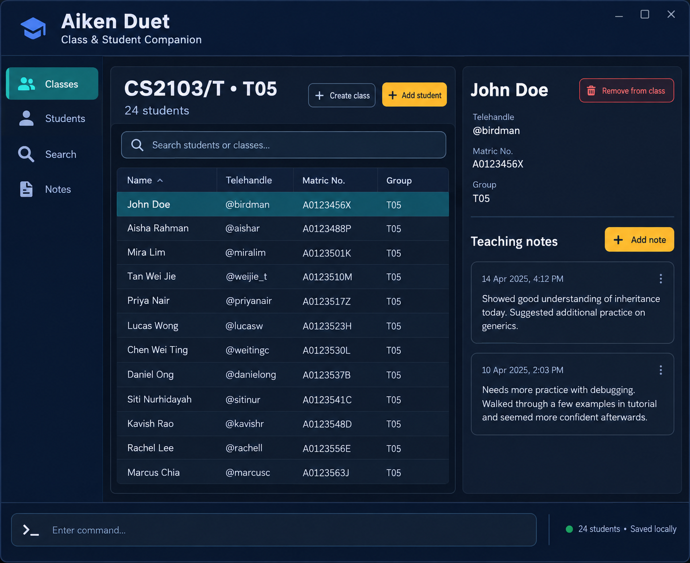

Aiken Duet is a **desktop application for Teaching Assistants (TA) to manage students in their classes, optimized for use through a Command Line Interface (CLI)** while retaining the benefits of a Graphical User Interface (GUI).

* Table of Contents
{:toc}

--------------------------------------------------------------------------------------------------------------------

## Quick start

1. Ensure that Java `25` is installed on your computer. Other Java versions are not supported. 
   **Mac users:** Ensure you have the precise JDK version prescribed [here](https://se-education.org/guides/tutorials/javaInstallationMac.html).

1. Download the latest `addressbook.jar` file from the
   [Aiken Duet releases page](https://github.com/AY2627S1-CS2103T-F10-2/tp/releases).

1. Copy the file to an empty, writable folder that you want to use as the _home folder_ for Aiken Duet.

1. Open a terminal, `cd` to the folder containing the JAR file, and run `java -jar addressbook.jar`. 
   A GUI similar to the one below should appear in a few seconds. Note how the app contains some sample data. 
   

1. Type a command in the command box and press Enter to execute it. For example, type **`help`** and press Enter to open the help window. 
   Some example commands you can try:

   * `lclass` to show all course classes.
   * `fclass T05 L01` to find course classes by class-group name.
   * `fstudent Alex` to find enrolled students by name.

1. Refer to the [Features](#features) section below for details of each command.

--------------------------------------------------------------------------------------------------------------------

## Features

**:information_source: Notes about the command format:** 

* Words in `UPPER_CASE` are the parameters to be supplied by the user. 
  For example, in `add n/NAME`, replace `NAME` with a value such as `John Doe`.

* Items in square brackets are optional. 
  For example, `n/NAME [t/TAG]` can be used as `n/John Doe t/friend` or as `n/John Doe`.

* Items followed by `…`​ can appear zero or more times. 
  For example, `[t/TAG]…​` may be omitted, or written as `t/friend` or `t/friend t/family`.

* Parameters can be in any order unless a command states otherwise. 
  For example, if the command specifies `n/NAME p/PHONE_NUMBER`, `p/PHONE_NUMBER n/NAME` is also acceptable.

* Extraneous parameters for commands that take no parameters, such as `help`, `lclass`, `exit`, and `cclass`, are ignored. 
  For example, `help 123` is interpreted as `help`.

* If you are using a PDF version of this document, be careful when copying and pasting commands that span multiple lines as space characters surrounding line-breaks may be omitted when copied over to the application.

### Viewing help: `help`

Shows a message explaining how to access the help page.

Format: `help`

### Adding a student to a class group: `add`

Adds a student to an existing class group in a specified module. The module name is required so that class groups with
the same name in different modules are distinguished.

Format: `add n/NAME t/TELEHANDLE c/CLASS_GROUP m/MODULE_NAME`

* `NAME` identifies the student's name.
* `TELEHANDLE` identifies the student's Telegram handle.
* `CLASS_GROUP` identifies the tutorial, laboratory, or recitation group.
* `MODULE_NAME` identifies the module containing the class group.
* All four prefixes are required. The prefixes can be entered in any order, but each prefix can only be used once.
* The class group must already exist.
* A student cannot be enrolled in the same class group more than once, but may be enrolled in different class groups.
* If the class group does not exist or the student is already enrolled, an error is shown and no data is changed.

Example:

* `add n/John Doe t/birdman c/T05 m/CS2103T` adds `John Doe` (@birdman) to `T05` in `CS2103T`.
  The application displays `John Doe has been successfully added to T05 in CS2103T`.

### Editing a class group: `eclass`

Edits an existing course class identified by its index in the displayed course-class list. Existing values are
overwritten by the supplied values. Enrolled students and their notes are preserved.

Format: `eclass INDEX [n/CLASS_GROUP] [c/MODULE_NAME] [t/TAG]…​`

* `INDEX` identifies the course class in the displayed list and must be a positive integer.
* At least one field must be supplied. The `n/` and `c/` prefixes can each be used at most once.
* `n/CLASS_GROUP` replaces the class-group name.
* `c/MODULE_NAME` replaces the module name.
* `t/TAG` replaces the complete set of tags. To remove all tags, use `t/` with no value.
* The edited class group and module combination must not duplicate another course class.

Example:

* `eclass 1 n/L01 t/lab` updates the first displayed course class to `L01` and replaces its tags with `lab`.

### Updating class homework status: `hwork`

Sets the homework status shared by every student in a displayed course class. The status is shown on the class card
and is saved automatically.

Format: `hwork INDEX s/STATUS`

* `INDEX` identifies the course class in the displayed list and must be a positive integer.
* `STATUS` must be one of `pending`, `completed`, or `not-set`.
* Updating the status changes the class-level status only; students and their notes are unchanged.
* If the class list is filtered, the current filter remains active after the status is updated.

Example:

* `hwork 1 s/completed` marks the first displayed course class's homework as completed for the whole class.

### Deleting a course class: `dclass`

Deletes a course class identified by its index in the displayed course-class list. The course class and its enrolled
students and notes are removed from the course-class book without a confirmation prompt.

Format: `dclass INDEX`

* `INDEX` identifies the course class in the displayed list and must be a positive integer.

Example:

* `dclass 1` deletes the first displayed course class.

If the deletion was accidental, enter `undo` immediately afterwards to restore the deleted course class.

### Adding a class: `aclass`

Adds a class group to the system.

Format: `aclass n/NAME c/COURSE_CODE [t/TAG]…​`

* `NAME` is the class group name.
* `COURSE_CODE` identifies the module containing the class group.
* `t/TAG` is optional and can be provided multiple times.
* The `n/` and `c/` prefixes are required and can be entered in either order. Each can be used only once.
* A class is considered a duplicate when it has the same name and course code as an existing class, regardless of tags.
* After a class is added, it appears in the class list and is saved automatically.

Examples:
* `aclass n/F10-2 c/CS2103T` adds a class group without tags.
* `aclass n/F10-2 c/CS2103T t/tutorial t/odd-week` adds a class group with two tags.

If the required prefixes are missing, duplicated, or contain invalid values, the application shows the command format
and does not add the class. Attempting to add an existing class shows `This class already exists in the system.`

### Removing a student from a class group: `dstudent`

Removes a student's enrolment from one class group without removing the student's enrolments in other classes.
The student is identified by their telehandle, while the class group and module identify the enrolment to remove.
The module name is required so that class groups with the same name in different modules are distinguished.

Format: `dstudent t/TELEHANDLE c/CLASS_GROUP m/MODULE_NAME`

* `TELEHANDLE` identifies the student.
* `CLASS_GROUP` identifies the tutorial, laboratory, or recitation group.
* `MODULE_NAME` identifies the module containing the class group.
* All three prefixes are required. The prefixes can be entered in any order, but each prefix can only be used once.
* The command first displays the matching student and asks for confirmation before changing any data.
* Type `yes` to remove the enrolment, or `no` to cancel without changing any data.
* If the input is neither `yes` nor `no`, the application asks for a valid confirmation again and keeps the deletion pending.
* If the class group or enrolment cannot be found, an error is shown and no data is changed.

Example:

1. Enter `dstudent t/birdman c/T05 m/CS2103T`. 
   The application displays `Remove John Doe (@birdman) from T05 in CS2103T? Type yes to confirm or no to cancel.`
1. Enter `yes` to remove `@birdman` from `T05` in `CS2103T`. 
   The application displays `Student @birdman has been removed from T05 in CS2103T`.

If the removal was accidental, enter `undo` immediately afterwards to restore the student to the class.

To cancel the operation, enter `no` after the confirmation prompt. The application displays
`Student deletion cancelled. No records were changed.`

### Adding a note to a student: `note`

Adds a timestamped teaching observation to a student enrolled in a specific class group.
The module name is required so that class groups with the same name in different modules are distinguished.

Format: `note t/TELEHANDLE c/CLASS_GROUP m/MODULE_NAME o/OBSERVATION`

* `TELEHANDLE` identifies the student.
* `CLASS_GROUP` identifies the tutorial, laboratory, or recitation group.
* `MODULE_NAME` identifies the module containing the class group.
* `OBSERVATION` must contain at least one visible character. Whitespace and invisible Unicode characters alone are
  rejected.
* `o/OBSERVATION` must be the final parameter. Everything after `o/` is treated as observation text, so the
  observation may contain prefix-like text such as `m/ath`.
* The date and time are generated automatically when the command is executed.
* Notes appear below the student's name and Telegram handle in the selected class. They are numbered and displayed
  in recorded order, from oldest to newest, for example `1. [14 Oct 2026, 21:30] Needs follow-up`. Long observations
  wrap within the student card.

Example:

* `note t/birdman c/T05 m/CS2103T o/Needs follow-up on tutorial participation` records the observation for
  `@birdman` in `T05` of `CS2103T`.

### Deleting a note from a student: `dnote`

Deletes a numbered note from a student enrolled in a specific class group. The module name is required so that class
groups with the same name in different modules are distinguished.

Format: `dnote t/TELEHANDLE c/CLASS_GROUP m/MODULE_NAME i/NOTE_INDEX`

* `TELEHANDLE` identifies the student.
* `CLASS_GROUP` identifies the tutorial, laboratory, or recitation group.
* `MODULE_NAME` identifies the module containing the class group.
* `NOTE_INDEX` is the positive number displayed beside the note.
* All four prefixes are required. They can be entered in any order, but each prefix can only be used once.
* The note is deleted immediately. If the deletion was accidental, it can be restored with `undo` provided no newer
  data change has been made.
* The command changes only the specified enrolment. Notes belonging to the same student in another class are not
  affected.
* If the class, student, or note index cannot be found, an error is shown and no data is changed.

Example:

* `dnote t/birdman c/T05 m/CS2103T i/2` deletes note 2 from `@birdman` in `T05` of `CS2103T`.

If the deletion was accidental and no newer data change has been made, enter `undo` to restore the note.

### Finding enrolled students by name: `fstudent`

Finds students enrolled in any class whose names contain at least one of the supplied keywords.
Each result includes the student's Telegram handle, class group, and module so that students with the same name
can be distinguished.

Format: `fstudent KEYWORD [MORE_KEYWORDS]`

* The search is case-insensitive.
* Only full words in student names match; for example, `Alex` matches `Alex Tan`, but `Ale` does not.
* When several keywords are supplied, a student matching any keyword is returned.
* A student enrolled in multiple classes is shown once for each enrolment.
* At least one non-blank keyword must be supplied. Otherwise, Aiken Duet displays the valid command format.
* If no student enrolment matches, Aiken Duet displays `No matching student enrolments found.`
* This command only displays results; it does not modify any student or class data.

Examples:

* If `Alex Tan` (`@alextan`) is enrolled in `T05` for `CS2103T`, `fstudent Alex` returns: 
  `1 matching student enrolment(s) found:` 
  `1. Alex Tan (@alextan) — T05, CS2103T`
* `fstudent Alex Bernice` finds students whose names contain either `Alex` or `Bernice`.
* `fstudent Ale` does not match `Alex Tan` and displays `No matching student enrolments found.`
* `fstudent` is rejected and displays the valid command format because no keyword was supplied.

### Finding classes by class-group name: `fclass`

Finds class groups whose names contain at least one of the supplied keywords and displays the matching classes.

Format: `fclass KEYWORD [MORE_KEYWORDS]`

* The search is case-insensitive and matches full words.
* When several keywords are supplied, a class matching any keyword is returned.

Example:

* `fclass T05 L01` finds class groups whose names contain either `T05` or `L01`.

### Listing all course classes: `lclass`

Displays all course classes in the course-class book.

Format: `lclass`

### Clearing all course classes: `cclass`

Removes all course classes from the course-class book, including their enrolled students and notes.

Format: `cclass`

If the clearing was accidental, enter `undo` immediately afterwards to restore the course classes.

### Undoing the most recent change: `undo`

Restores the course-class data to the state before the most recent successful data-changing command.

Format: `undo`

Undo supports changes to course classes, student enrolments, notes, homework statuses, and clearing the course-class
book. For example, enter `undo` after `dclass 1` to restore the deleted class, or after confirming a `dstudent`
command to restore the removed student.

* Undo changes are applied one at a time, starting with the most recent change.
* You can enter `undo` repeatedly to reverse earlier successful changes.
* Failed commands and cancelled student-deletion confirmations do not create undo entries.
* Search, list, help, and exit commands do not create undo entries.
* Undo history is saved in `data/courseclasses.json` and remains available after restarting the application.
* The application does not currently provide a `redo` command.

If there is no saved change to undo, the application displays `There is no change to undo.`

### Exiting the program: `exit`

Exits the program.

Format: `exit`

### Saving the data

The application automatically saves the course-class data and undo history after every command that completes
successfully. You do not need to save manually.

### Editing the data file

Course-class data and undo history are saved automatically as a JSON file
`[JAR file location]/data/courseclasses.json`. Advanced users are welcome to update data directly by editing that data
file.

:exclamation: **Caution:**
If your changes make the data file invalid, the application starts with an empty course-class book at the next run. The
invalid file remains on disk until you run a command (the application saves after every successful command). Still, we
recommend backing up the file before editing it. 
Furthermore, certain edits can cause the application to behave in unexpected ways (e.g., if a value entered is outside
of the acceptable range). Therefore, edit the data file only if you are confident that you can update it correctly.

## FAQ

**Q**: How do I transfer my data to another computer? 
**A**: Install the app on the other computer and overwrite the `data/courseclasses.json` file it creates with the file
from your previous Aiken Duet home folder.

--------------------------------------------------------------------------------------------------------------------

## Known issues

1. **When using multiple screens**, if you move the application to a secondary screen, and later switch to using only the primary screen, the GUI will open off-screen. The remedy is to delete the `preferences.json` file created by the application before running the application again.
2. **If you minimize the Help Window** and then run the `help` command (or use the `Help` menu, or the keyboard shortcut `F1`) again, the original Help Window will remain minimized, and no new Help Window will appear. The remedy is to manually restore the minimized Help Window.

--------------------------------------------------------------------------------------------------------------------

## Command summary

Action | Format, Examples
--------|------------------
**Add class** | `aclass n/NAME c/COURSE_CODE [t/TAG]…​`  e.g., `aclass n/F10-2 c/CS2103T t/tutorial`
**Add student to class** | `add n/NAME t/TELEHANDLE c/CLASS_GROUP m/MODULE_NAME`  e.g., `add n/John Doe t/birdman c/T05 m/CS2103T`
**Edit course class** | `eclass INDEX [n/CLASS_GROUP] [c/MODULE_NAME] [t/TAG]…​`  e.g., `eclass 1 n/L01 t/lab`
**Update class homework status** | `hwork INDEX s/STATUS`  e.g., `hwork 1 s/completed`
**Delete course class** | `dclass INDEX`  e.g., `dclass 1`
**Remove student from class** | `dstudent t/TELEHANDLE c/CLASS_GROUP m/MODULE_NAME`  e.g., `dstudent t/birdman c/T05 m/CS2103T`, followed by `yes`
**Add student note** | `note t/TELEHANDLE c/CLASS_GROUP m/MODULE_NAME o/OBSERVATION`  e.g., `note t/birdman c/T05 m/CS2103T o/Needs follow-up`
**Delete student note** | `dnote t/TELEHANDLE c/CLASS_GROUP m/MODULE_NAME i/NOTE_INDEX`  e.g., `dnote t/birdman c/T05 m/CS2103T i/2`
**Find student** | `fstudent KEYWORD [MORE_KEYWORDS]`  e.g., `fstudent Alex Bernice`
**Find class** | `fclass KEYWORD [MORE_KEYWORDS]`  e.g., `fclass T05 L01`
**List course classes** | `lclass`
**Clear course classes** | `cclass`
**Undo most recent change** | `undo`  e.g., `undo`
**Help** | `help`
**Exit** | `exit`
